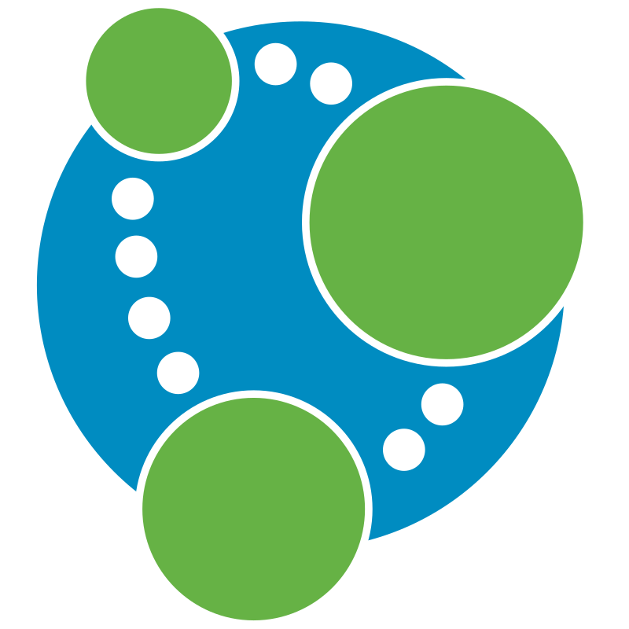
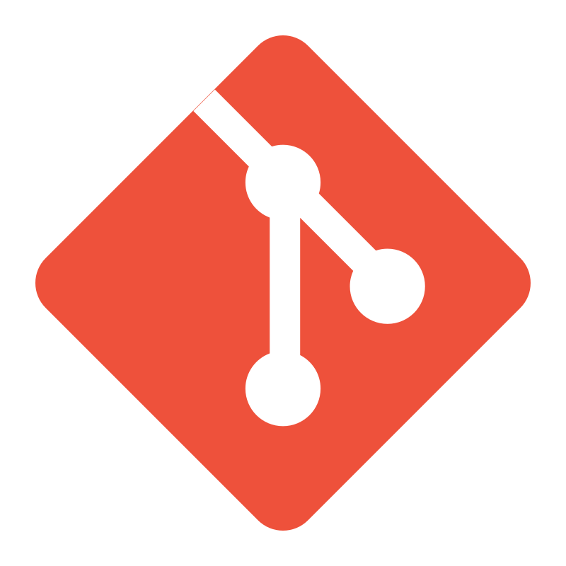

<h1 align="center">
    𝘏𝘦𝘭𝘭𝘰 𝘦𝘷𝘦𝘳𝘺𝘰𝘯𝘦! 𝘐'𝘮 𝘚𝘵𝘦𝘧𝘢𝘯 𝘒𝘭𝘦𝘱𝘪𝘬𝘰𝘸, 𝘢𝘬𝘢 <a href="https://stefplotva.ru/">
        𝘖𝘨𝘳𝘢𝘭𝘭
    </a>.
</h1>
<div align="center">
    Feel free and take a look at my GitHub account below!
</div>

---

<h2>
    My Skills :computer::
</h2>
<div align="center">
    
    
    
    
    
    
    
    
    
    
    
    
    
    
    
    
    
    
</div>
<h2>
    My GitHub statistics :bar_chart::
</h2>
<div align="center">
    <picture>
        <source srcset="./assets/stats_dark.svg" media="(prefers-color-scheme: dark)" /> <!-- Dark mode -->
         <!-- Light mode -->
    </picture>
    <picture>
        <source srcset="./assets/top_langs_dark.svg" media="(prefers-color-scheme: dark)" /> <!-- Dark mode -->
         <!-- Light mode -->
    </picture>
</div>
<div align="center">
    <picture>
        <source srcset="./assets/contribution_graph_dark.svg" media="(prefers-color-scheme: dark)" /> <!-- Dark mode -->
         <!-- Light mode TODO ???-->
    </picture>
</div>
<h2>
My weekly coding statistic breakdown :muscle::
</h2>

<!--START_SECTION:waka-->


**🐱 My GitHub Data** 

> 📦 ? Used in GitHub's Storage 
 > 
> 🏆 144 Contributions in the Year 2026
 > 
> 💼 Opted to Hire
 > 
> 📜 11 Public Repositories 
 > 
> 🔑 0 Private Repositories 
 > 
**I'm a Night 🦉** 

```text
🌞 Morning                14 commits          █░░░░░░░░░░░░░░░░░░░░░░░░   02.27 % 
🌆 Daytime                164 commits         ███████░░░░░░░░░░░░░░░░░░   26.62 % 
🌃 Evening                370 commits         ███████████████░░░░░░░░░░   60.06 % 
🌙 Night                  68 commits          ███░░░░░░░░░░░░░░░░░░░░░░   11.04 % 
```
📅 **I'm Most Productive on Sunday** 

```text
Monday                   92 commits          ████░░░░░░░░░░░░░░░░░░░░░   14.94 % 
Tuesday                  117 commits         █████░░░░░░░░░░░░░░░░░░░░   18.99 % 
Wednesday                38 commits          ██░░░░░░░░░░░░░░░░░░░░░░░   06.17 % 
Thursday                 78 commits          ███░░░░░░░░░░░░░░░░░░░░░░   12.66 % 
Friday                   45 commits          ██░░░░░░░░░░░░░░░░░░░░░░░   07.31 % 
Saturday                 80 commits          ███░░░░░░░░░░░░░░░░░░░░░░   12.99 % 
Sunday                   166 commits         ███████░░░░░░░░░░░░░░░░░░   26.95 % 
```


📊 **This Week I Spent My Time On** 

```text
💬 Programming Languages: 
Python                   5 hrs 36 mins       ██████░░░░░░░░░░░░░░░░░░░   24.81 % 
YAML                     4 hrs 52 mins       █████░░░░░░░░░░░░░░░░░░░░   21.57 % 
TypeScript               3 hrs 48 mins       ████░░░░░░░░░░░░░░░░░░░░░   16.85 % 
Docker                   1 hr 27 mins        ██░░░░░░░░░░░░░░░░░░░░░░░   06.44 % 
CSS                      1 hr 22 mins        ██░░░░░░░░░░░░░░░░░░░░░░░   06.09 % 

🔥 Editors: 
VS Code                  19 hrs 45 mins      ██████████████████████░░░   87.34 % 
Codex Vscode             2 hrs 51 mins       ███░░░░░░░░░░░░░░░░░░░░░░   12.66 % 

🐱‍💻 Projects: 
TaskForZemlianika        16 hrs 21 mins      ██████████████████░░░░░░░   72.30 % 
main_gate                2 hrs 32 mins       ███░░░░░░░░░░░░░░░░░░░░░░   11.22 % 
AFinA                    2 hrs 12 mins       ██░░░░░░░░░░░░░░░░░░░░░░░   09.74 % 
TaskForLaretto           1 hr 31 mins        ██░░░░░░░░░░░░░░░░░░░░░░░   06.74 % 

💻 Operating System: 
Windows                  22 hrs 37 mins      █████████████████████████   100.00 % 
```

🤖 **AI Coding This Week** 

```text
⏱ AI Coding Time: 5 hrs 51 mins (25.91%)

✍️ 657 lines written by AI, 2,830 lines written by hand (18.84% AI-written)

🔤 510,919 Input Tokens, 67,179 Output Tokens

💵 $6.06 Estimated AI Cost This Week

🧠 5 AI Sessions, 84 AI Prompts

GPT                      683 lines           █████████████████████████   100.00 % 

🔎 AI Coding Insights:
🧑‍💻 Mostly Hands-On — 18.84% of written lines came from AI
📝 Concise Prompter — average 212 characters per prompt
🔁 Iterative Prompter — average 17 prompts per session
🔍 Hands-On Reviewer — 83.88% of changed lines were hand-edited
```

**I Mostly Code in Python** 

```text
Python                   4 repos             ███████████░░░░░░░░░░░░░░   44.44 % 
TypeScript               2 repos             ██████░░░░░░░░░░░░░░░░░░░   22.22 % 
HTML                     2 repos             ██████░░░░░░░░░░░░░░░░░░░   22.22 % 
JavaScript               1 repo              ███░░░░░░░░░░░░░░░░░░░░░░   11.11 % 
```


**Timeline**


<!--END_SECTION:waka-->


<!--
**OgrallSerebroust/OgrallSerebroust** is a ✨ _special_ ✨ repository because its `README.md` (this file) appears on your GitHub profile.

Here are some ideas to get you started:

- 🔭 I’m currently working on ...
- 🌱 I’m currently learning ...
- 👯 I’m looking to collaborate on ...
- 🤔 I’m looking for help with ...
- 💬 Ask me about ...
- 📫 How to reach me: ...
- 😄 Pronouns: ...
- ⚡ Fun fact: ...
-->
