<h1 align="center">
    𝘏𝘦𝘭𝘭𝘰 𝘦𝘷𝘦𝘳𝘺𝘰𝘯𝘦! 𝘐'𝘮 𝘚𝘵𝘦𝘧𝘢𝘯 𝘒𝘭𝘦𝘱𝘪𝘬𝘰𝘸, 𝘢𝘬𝘢 <a href="https://stefplotva.ru/">
        𝘖𝘨𝘳𝘢𝘭𝘭
    </a>.
</h1>
<div align="center">
    Feel free and take a look at my GitHub account below!
</div>

---

<h2>
    My Skills :computer::
</h2>
<div align="center">
    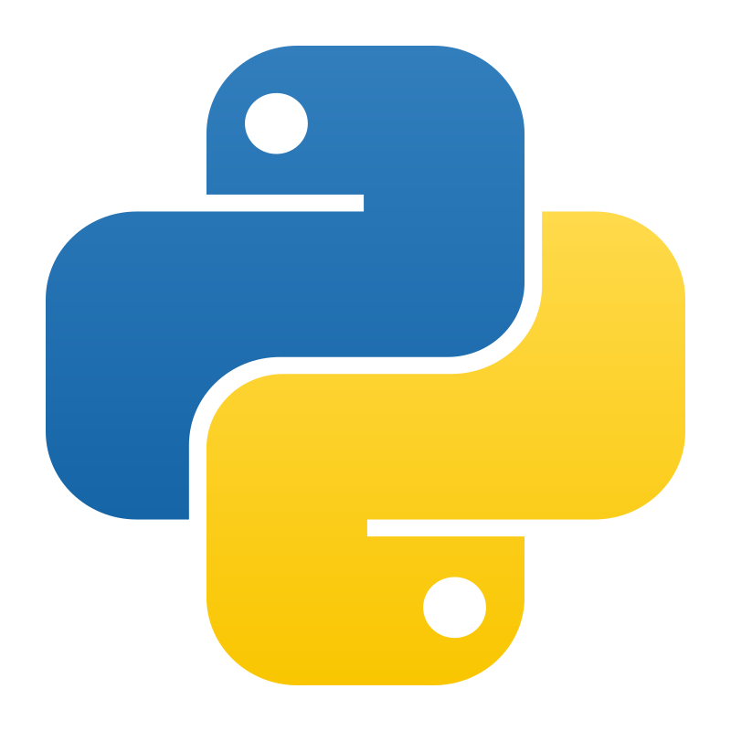
    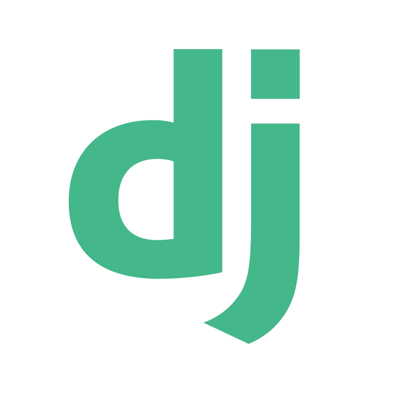
    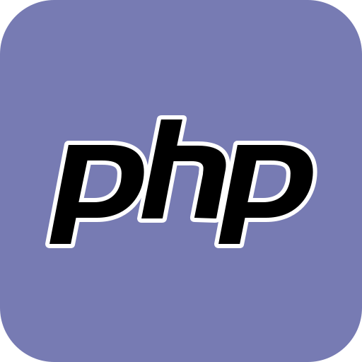
    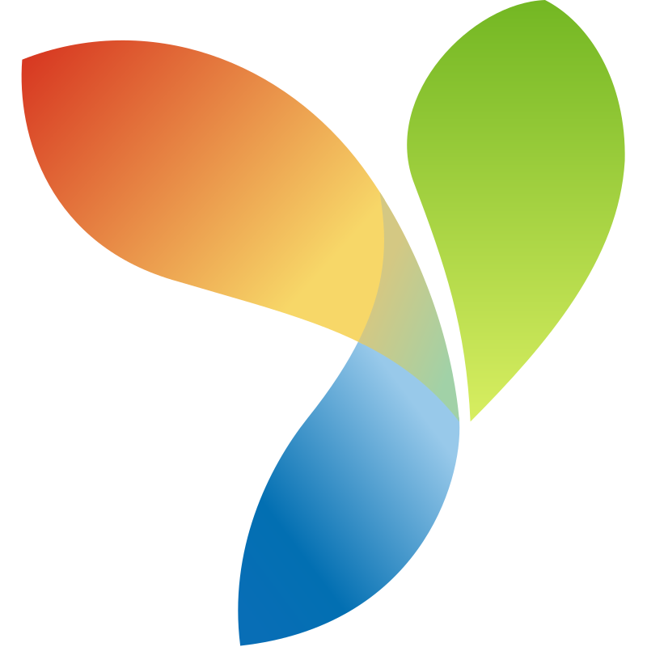
    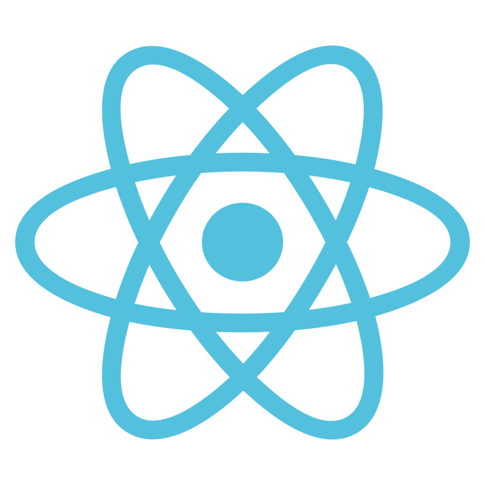
    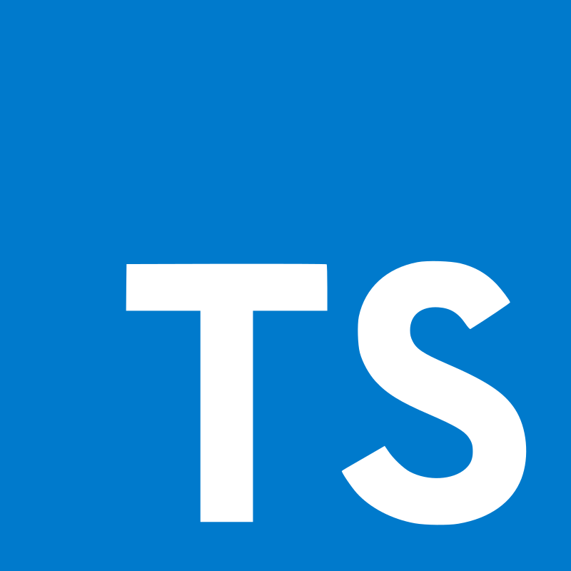
    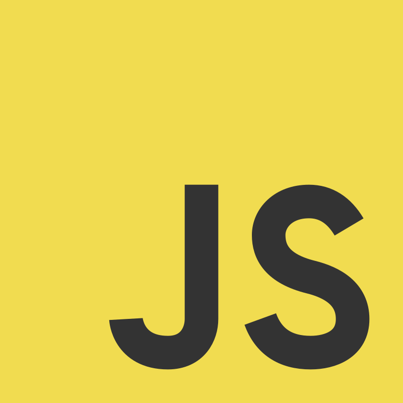
    
    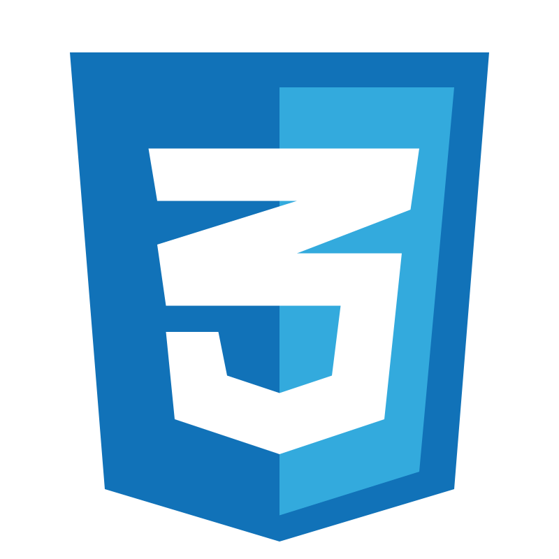
    
    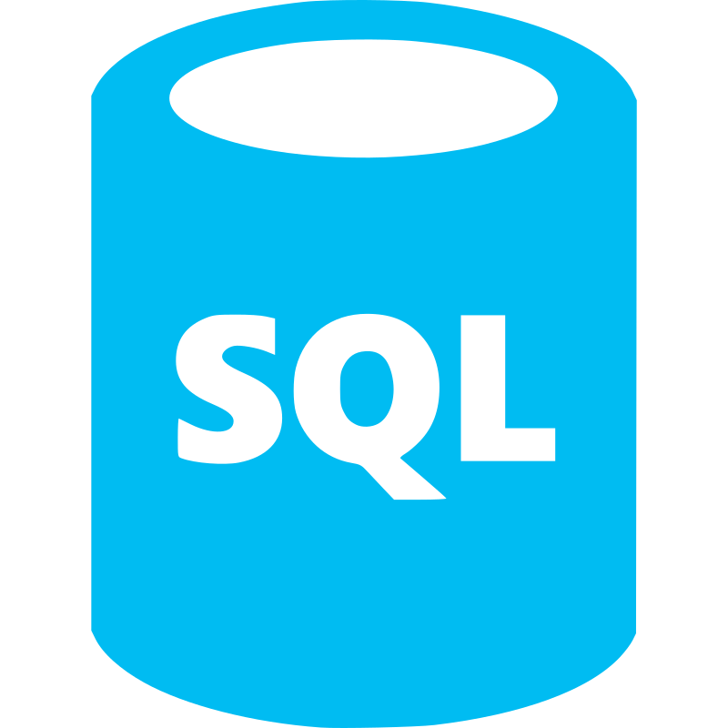
    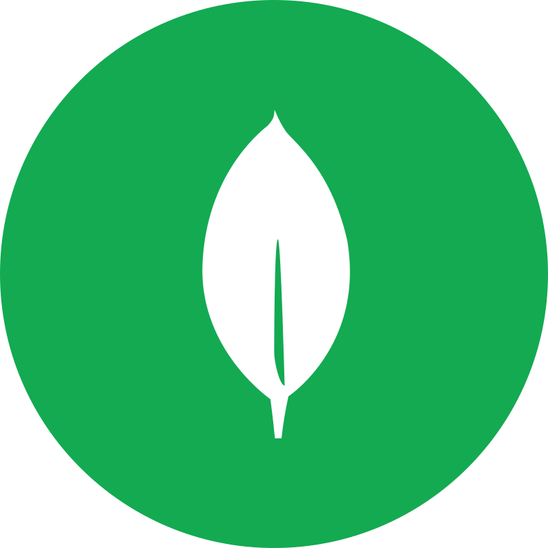
    
    
    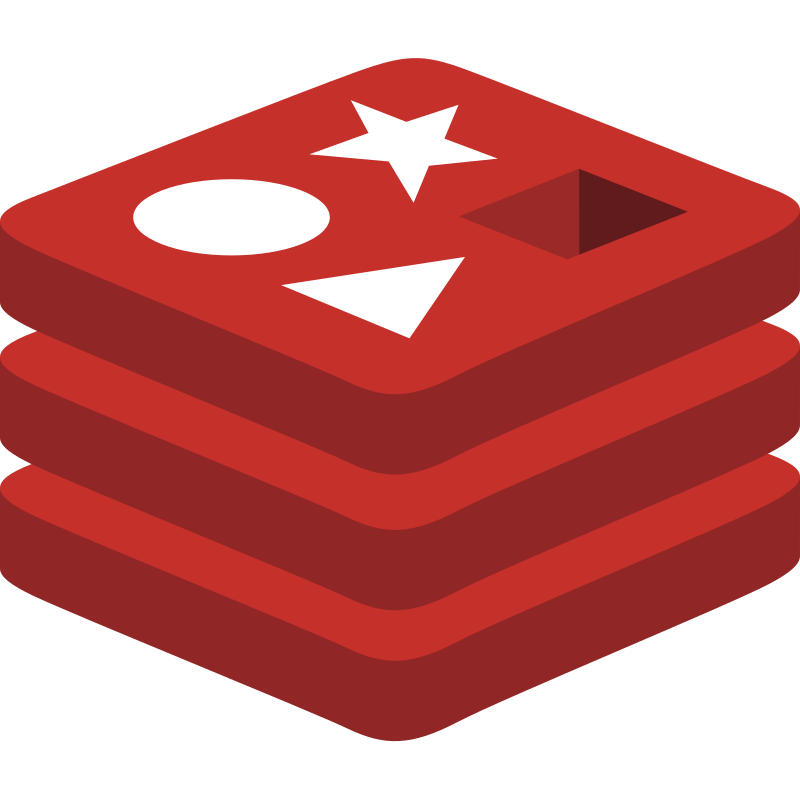
    
    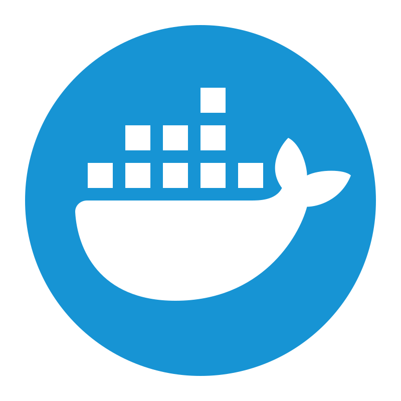
    
</div>
<h2>
    My GitHub statistics :bar_chart::
</h2>
<div align="center">
    <picture>
        <source srcset="./assets/stats_dark.svg" media="(prefers-color-scheme: dark)" /> <!-- Dark mode -->
         <!-- Light mode -->
    </picture>
    <picture>
        <source srcset="./assets/top_langs_dark.svg" media="(prefers-color-scheme: dark)" /> <!-- Dark mode -->
         <!-- Light mode -->
    </picture>
</div>
<div align="center">
    <picture>
        <source srcset="./assets/contribution_graph_dark.svg" media="(prefers-color-scheme: dark)" /> <!-- Dark mode -->
         <!-- Light mode TODO ???-->
    </picture>
</div>
<h2>
My weekly coding statistic breakdown :muscle::
</h2>

<!--START_SECTION:waka-->


**🐱 My GitHub Data** 

> 📦 ? Used in GitHub's Storage 
 > 
> 🏆 117 Contributions in the Year 2026
 > 
> 💼 Opted to Hire
 > 
> 📜 10 Public Repositories 
 > 
> 🔑 0 Private Repositories 
 > 
**I'm a Night 🦉** 

```text
🌞 Morning                14 commits          █░░░░░░░░░░░░░░░░░░░░░░░░   02.69 % 
🌆 Daytime                138 commits         ███████░░░░░░░░░░░░░░░░░░   26.49 % 
🌃 Evening                342 commits         ████████████████░░░░░░░░░   65.64 % 
🌙 Night                  27 commits          █░░░░░░░░░░░░░░░░░░░░░░░░   05.18 % 
```
📅 **I'm Most Productive on Sunday** 

```text
Monday                   92 commits          ████░░░░░░░░░░░░░░░░░░░░░   17.66 % 
Tuesday                  117 commits         ██████░░░░░░░░░░░░░░░░░░░   22.46 % 
Wednesday                38 commits          ██░░░░░░░░░░░░░░░░░░░░░░░   07.29 % 
Thursday                 24 commits          █░░░░░░░░░░░░░░░░░░░░░░░░   04.61 % 
Friday                   34 commits          ██░░░░░░░░░░░░░░░░░░░░░░░   06.53 % 
Saturday                 50 commits          ██░░░░░░░░░░░░░░░░░░░░░░░   09.60 % 
Sunday                   166 commits         ████████░░░░░░░░░░░░░░░░░   31.86 % 
```


📊 **This Week I Spent My Time On** 

```text
💬 Programming Languages: 
YAML                     2 hrs 7 mins        ████████████░░░░░░░░░░░░░   47.93 % 
Docker                   1 hr 36 mins        █████████░░░░░░░░░░░░░░░░   36.27 % 
Git Config               26 mins             ██░░░░░░░░░░░░░░░░░░░░░░░   09.96 % 
Python                   9 mins              █░░░░░░░░░░░░░░░░░░░░░░░░   03.43 % 
TOML                     2 mins              ░░░░░░░░░░░░░░░░░░░░░░░░░   01.12 % 

🔥 Editors: 
VS Code                  4 hrs 25 mins       █████████████████████████   100.00 % 

🐱‍💻 Projects: 
AFinA                    4 hrs 21 mins       █████████████████████████   98.39 % 
TaskForLaretto           4 mins              ░░░░░░░░░░░░░░░░░░░░░░░░░   01.60 % 
AFinA-chore-set-up-backen0 secs              ░░░░░░░░░░░░░░░░░░░░░░░░░   00.01 % 

💻 Operating System: 
Windows                  4 hrs 25 mins       █████████████████████████   100.00 % 
```

🤖 **AI Coding This Week** 

```text
⏱ AI Coding Time: 10 mins (3.88%)

✍️ 0 lines written by AI, 501 lines written by hand (0.0% AI-written)

🔤 11,588 Input Tokens, 490 Output Tokens

💵 $0.20 Estimated AI Cost This Week

🧠 1 AI Sessions, 1 AI Prompts

GPT                      0 lines             ░░░░░░░░░░░░░░░░░░░░░░░░░   00.00 % 

🔎 AI Coding Insights:
🧑‍💻 Mostly Hands-On — 0.0% of written lines came from AI
📄 Detailed Prompter — average 704 characters per prompt
🎯 One-Shot Prompter — average 1 prompts per session
🔍 Hands-On Reviewer — 100.0% of changed lines were hand-edited
```

**I Mostly Code in Python** 

```text
Python                   4 repos             ████████████░░░░░░░░░░░░░   50.00 % 
HTML                     2 repos             ██████░░░░░░░░░░░░░░░░░░░   25.00 % 
TypeScript               1 repo              ███░░░░░░░░░░░░░░░░░░░░░░   12.50 % 
JavaScript               1 repo              ███░░░░░░░░░░░░░░░░░░░░░░   12.50 % 
```


**Timeline**

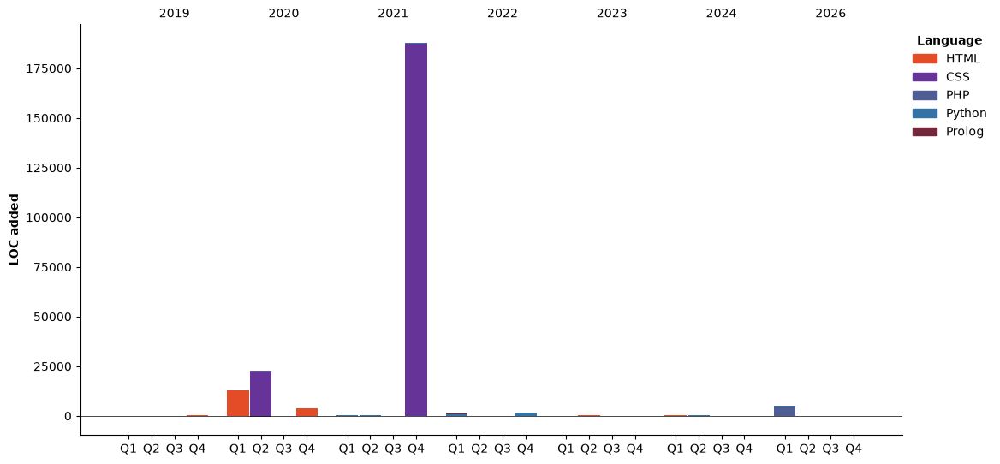


<!--END_SECTION:waka-->


<!--
**OgrallSerebroust/OgrallSerebroust** is a ✨ _special_ ✨ repository because its `README.md` (this file) appears on your GitHub profile.

Here are some ideas to get you started:

- 🔭 I’m currently working on ...
- 🌱 I’m currently learning ...
- 👯 I’m looking to collaborate on ...
- 🤔 I’m looking for help with ...
- 💬 Ask me about ...
- 📫 How to reach me: ...
- 😄 Pronouns: ...
- ⚡ Fun fact: ...
-->
